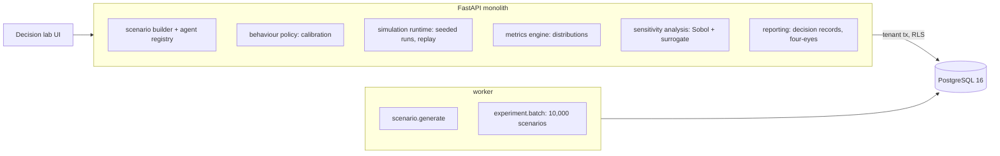

# Multi-Agent Enterprise Simulation & Decision Laboratory

For strategy teams who have to answer "what happens if we raise prices?": it models a subscription business as agents (customer
cohorts that cancel or stay, prospects who sign up or not, a competitor in each market, a retention desk with a capacity), calibrates
each agent's behaviour from the company's own history, runs a plan through 10,000 seeded scenarios that carry the calibration's
uncertainty, replays any scenario bit for bit, says which unknowns the answer depends on, and turns the result into a decision record
that a second person signs.

Built from blueprint 18 of "Advanced Engineering Build Book, Volume IV" as a **vertical slice**: the demo scenario end to end, with
the platform parts real and the rest listed under [Not built](#not-built-and-why).

**The business, its customers, its 36 months of history and the competitor are generated by a simulator in this repository; nothing
is a real company or real customer data. The true behaviour behind the history (customers in three hidden price-sensitivity tiers,
the competitor's real reaction policy) is used only to judge the calibrated agents, which never see it. No language model is used.**

## Run it

```bash
docker compose up --build        # migrates, seeds, serves http://localhost:8400/ui/ with one worker
docker compose run --rm test     # 9 tests against a throwaway database (about a minute)
```

Open http://localhost:8400/ui/ and press **Run all steps** (about a minute: 30,000 arm-runs, then 9,216 for the sensitivity
analysis), or `make bootstrap demo`. Demo tokens (local only): `atlas-partner-demo`, `atlas-strategist-demo`, `atlas-viewer-demo`.
Run `make reset` before a second demo run.

## The demo, step by step

1. **A subscription business.** Brightline, an invented software company: Starter $29, Team $99, Business $399 a month, eight
   markets, 59,733 customers, $5.26M a month. 36 months of history: every cohort's customers at risk, cancellation requests and saves
   (3,456 cohort-months), 19 price rises (the largest 10%), the competitor's price scraped from its website. 129 agents.
2. **Agents calibrated from history.** Cancellation requests as a binomial hazard with plan, market and tenure effects, our price,
   the gap to the competitor's scraped price, and a notice shock κ·(rise/5%)^ψ in the month of a rise. Fitted: κ 0.156 (truth 0.09),
   ψ 1.8 with a 90% range of 1.3–2.2 (truth 1.7). Inside the history the fit is right (a 4% rise: +20% requests that month against a
   true +19%); at 12% it extrapolates and says +145% against a true +110%, with an 80% band of +115% to +180%, 15 times wider than at
   4%. The competitor answered 6 of our 10 rises of 5% or more with a discount: reaction probability 0.58 (90%: 0.35–0.80; truth
   0.45). A spreadsheet comparing markets gets an elasticity of −0.52, the wrong sign, because the company priced its loyal markets
   higher.
3. **One seeded run** of the status quo against a 12% rise with a 20% competitor discount: 22 events, the retention desk full for
   four months, 24,354 customers lost against 16,829.
4. **10,000 seeded scenarios**, three arms, 23 s (2.3 ms a scenario). The plain rise: 12-month revenue +$1.85M on average (80% of
   scenarios between +$1.00M and +$2.67M), up in 99.5% of them; truth +$1.92M, so the model is 4% low. With the discount: +$0.42M,
   up in 77% (truth +$0.30M, 41% high). The spreadsheet says +$8.02M for both, 4.2 times the true gain. In month 12 the plain rise is
   at −$12k a month against the status quo (truth −$34k) and the discount arm at −$132k (truth −$165k), with about 10,000 and 11,700
   fewer customers: the rise pays for a year and then costs.
5. **Replay an outlier exactly.** The worst scenario for the discount arm (number 8,788, −$2.05M) is replayed from its entropy and
   index and the policy version it ran with: the result hash matches bit for bit, and this time its 32 events are recorded. It drew a
   curvature of 2.6 against a best estimate of 1.8: the tail the history cannot rule out.
6. **What the answer depends on.** Sobol indices over seven inputs, 9,216 runs, 16.5 s: the notice-shock curvature (total index 0.33),
   our customers' sensitivity to the competitor's price (0.26) and the competitor's discount depth (0.25) explain the most. A quadratic
   surrogate predicts held-out runs with R² 0.98 and gives the same ranking.
7. **A decision, and who signs it.** The policy abstains (`review`): 12-month revenue rises in 99% of scenarios, but monthly revenue
   at month 12 is below the status quo in 57% of them (99.7% with the discount), and a 12% rise is beyond anything
   in the history. The strategist cannot approve their own proposal (`four_eyes`); the partner records a staged test. The audit chain
   verifies.

## Architecture



| Piece | How it works |
|---|---|
| Simulator (`es/world.py`) | Customers are agents grouped into cohorts (8 markets x 3 plans x 4 tenure bands, and in the true world x 3 hidden sensitivity tiers) and drawn binomially each month: cancellation requests from a logistic hazard, saves by a retention desk that saves a quarter of requests up to a monthly capacity (a full desk saves exactly its capacity), ageing between tenure bands, Poisson signups that fall as we get dearer than the competitor. The competitor runs its own promotions and answers our rises of 5% or more with a discount. One function runs both the true world and the calibrated model. |
| History | 24 months of warm-up, then 36 recorded months. Management raised prices more often in loyal markets and right after the competitor raised its own, and once tested +10% in its most loyal market: the confounding a spreadsheet falls into. The competitor's price reaches the company only through a scrape with 2% noise. |
| Calibration (`es/engine.py`) | Churn: binomial GLM by Newton's method on cancellation requests per cohort-month with market fixed effects; the curvature ψ profiled on a 25-point grid, each point with its Laplace covariance. Signups: Poisson GLM with market x plan effects. Competitor: promotions read off the scraped price (8% below the median of the previous three months), a reaction when one starts within two months of our rise; Beta posterior on the reaction probability. |
| Scenarios | Scenario *i* of an experiment uses `default_rng([entropy, i])` and nothing else: it draws ψ from the profile likelihood, the other parameters from the Laplace approximation, the competitor's reaction probability from its posterior, the competitor's promotions, then the agents. Every arm of a scenario shares those draws (common random numbers), so the change against the status quo is paired. The result hash is SHA-256 of the monthly revenue, churn, signups and customers. |
| Comparisons | A spreadsheet (last year's churn and signups, churn scaled by price^elasticity from a pooled cross-market regression; and the same with no response), and the true world: 2,000 runs with the true customers, parameters and competitor. |
| Sensitivity | Saltelli sampling with Jansen's estimators for first-order and total Sobol indices of the revenue change; a quadratic regression surrogate fitted on the A sample, scored on the B sample, and its own indices from 40,000 points. |
| Decision policy | Adopt if revenue rises in at least 90% of scenarios in every arm, monthly revenue at the horizon rises in at least half, and the plan stays within the history's largest rise; reject at 20% or less; otherwise abstain and send to review. Every decision is stored with its evidence, policy version and an inputs hash, and needs a second person. |
| Platform | Row-level security per tenant, Postgres job queue, Idempotency-Key replay, hash-chained audit log, `/metrics`. |

## Data model

`migrations/002_sim.sql` follows the blueprint (scenario, agent_type, agent_instance, behavior_policy, assumption, simulation_run,
random_seed, event, metric, experiment, result_distribution, decision_record). Additions are marked `(+)`: the scenario's seed and
current state, cohort_month and market_month (the calibration dataset), per-run outcome arrays and result hash, the approver's final
outcome. The blueprint's model_artifact is behavior_policy: versioned, approved when a decision built on it is signed.

## API

| Method | Endpoint | Purpose |
|---|---|---|
| POST | `/v1/scenarios` | 202 + job: build the business, its history, agents and assumptions |
| GET | `/v1/scenarios/{id}` | (+) The business today, its history, agents, assumptions |
| POST | `/v1/scenarios/{id}/calibrate` | (+) Fit the agents' behaviour; store versioned policies |
| POST | `/v1/runs` | One seeded run; events and monthly metrics stored |
| GET | `/v1/runs/{id}/events` | The event stream and monthly series of a run |
| POST | `/v1/runs/{id}/replay` | Re-run from the stored seed and policy version; check the hash |
| POST | `/v1/experiments/batch` | 202 + job: N seeded scenarios through every arm |
| GET | `/v1/experiments/{id}/distributions` | Distributions, paired changes, outliers, spreadsheet, truth |
| POST | `/v1/experiments/{id}/sensitivity` | (+) Sobol indices and a surrogate |
| POST | `/v1/experiments/{id}/decision` · `/decision/approve` | (+) Recommendation with evidence; four-eyes sign-off |

Contract: [`docs/openapi.json`](docs/openapi.json).

## Measured

[`docs/evaluation.md`](docs/evaluation.md) (`python -m es.evaluate`, five businesses the demo never uses) and
[`docs/performance.md`](docs/performance.md).

| Question | Calibrated agents | Spreadsheet |
|---|---|---|
| Churn response to a 4% rise (inside the history) | within 3 points of the truth on all five | elasticity −0.79 to +0.63: wrong sign, none, or right sign by luck |
| Churn response to a 12% rise (outside it) | −21% to +70% of the true response | – |
| 12-month revenue change, +12% | 10–37% off the truth (three high, two low) | +$7.2–8.3M against a true +$2.4–2.9M: about 3x |
| 12-month revenue change, +12% with a 20% discount | 8–85% off; on one business +$0.19M (P(up) 64%) against a true +$1.25M | same |
| Sign of the month-12 monthly revenue change | agrees with the truth in 9 of 10 | – |
| True outcomes inside the model's 80% interval | 58% (2–100% by business) | – |
| Replay | identical hash, every time (tested) | – |

What these say plainly. The agents beat the spreadsheet by a wide margin, because the spreadsheet both gets the sign of price
sensitivity wrong and lets nobody react. But the agents' answer to the question actually asked, how much a 12% rise is worth, is off
by tens of percent: each year's revenue is forecast within a few percent, and the change is a small difference of two large numbers.
Their intervals are too narrow: an 80% interval held the true outcome 58% of the time, because the hidden sensitivity tiers are a
misspecification no amount of parameter uncertainty covers. The useful output is less the number than the shape: the rise pays for
a year and then costs, and the unknowns that move it most are the shape of the customers' reaction to a large rise and the competitor's answer.

## The hardest tradeoff

What to report as the answer. A simulator produces a distribution, and the easy thing is to report "P(revenue up) = 100%" and stop.
That number is true of the model and nearly meaningless about the world: the model's parameters came from rises half the size of the
proposal, and the true outcome falls outside its 80% interval four times in ten. So the decision policy abstains when the plan extrapolates, every
decision carries the reasons alongside the probability, the page shows the month-by-month shape and not only the 12-month total, and
the sensitivity analysis says which unknown to go and measure (here, the reaction to a rise of this size) instead of offering more decimal places.

## Threat model (summary)

| Threat | Mitigation here | Gap |
|---|---|---|
| A result nobody can reproduce | Every run stores entropy, index, policy version and a result hash; replay is an API call and checks the hash | Bit for bit only on the same platform and NumPy version: the same seeds on macOS give different histories. The image pins both |
| A decision pushed through by its author | Four-eyes: the proposer cannot approve; only a partner can; the approver's final outcome is recorded separately from the policy's | No SSO, demo tokens only |
| Over-trusting the model | Abstention when extrapolating; reasons and the policy version stored with every decision; the truth comparison in the evaluation | A real deployment has no truth to compare with |
| One client seeing another's scenario | Row-level security on every table; tested through the API and directly in the database | |
| Tampering with history | Hash-chained, append-only audit log (UPDATE and DELETE refused by trigger) | |

## Not built, and why

- **Bounded LLM agents with tool and action schemas**: the blueprint lists them; every agent here is rule-based or probabilistic.
  A language model's behaviour cannot be calibrated against 36 months of churn or replayed bit for bit, which are the two things this
  slice is about.
- **Employees and suppliers as agents**: the retention desk is the only staff agent; suppliers do not matter to a pricing decision.
- **SSE/WebSocket progress**: jobs are polled through `/v1/jobs/{id}`.
- **A scenario workspace UI for editing assumptions, an operations inbox, PDF/CSV export**: the API takes arms and returns JSON.
- **Real data**: generated instead, so the calibrated agents can be scored against the truth.
- **Kafka, Redis, Kubernetes, Terraform, SSO, CI**: not needed to prove the slice; no cloud account used.

## Commercial sketch

Buyer: strategy teams, consulting firms, universities, PE operating teams. Pricing shape from the blueprint: per-seat licences for
the lab, simulation compute credits, private deployment for consulting firms.

## Layout

```
core/        platform kit: db + RLS, jobs, audit chain, HTTP, scenario runner, load test
es/          world (business, agents, simulator), engine (calibration, scenarios, spreadsheet, truth, Sobol), api, seed, evaluate
migrations/  forward-only SQL          web/   UI, scenario.json, demo.json (recorded run)
tests/       9 tests                   docs/  evaluation.md, performance.md, openapi.json
```
